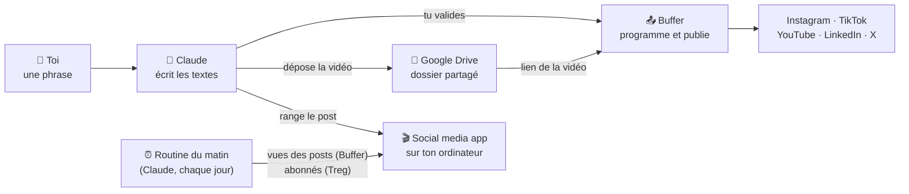

# 🎬 Social media app

**Ton cockpit de réseaux sociaux, piloté par Claude.** Tu demandes en une phrase, Claude écrit les textes,
programme tes posts et suit tes statistiques. Tout tourne sur ton ordinateur : rien à héberger, aucun code à
toucher.

<sub>Créé par [@mapplesyrup](https://github.com/mapplesyrup) · licence MIT · gratuit</sub>

---

## Ce que permet l'app

Quatre écrans, que Claude remplit pour toi :

| Écran | Ce que tu y vois |
|---|---|
| 📊 **Statistiques** | tes abonnés et les vues de tes posts, réseau par réseau, mis à jour chaque matin |
| 🗓️ **Calendrier** | tes publications programmées, jour par jour |
| 🎬 **Bibliothèque** | chaque post avec sa vidéo et ses textes pour chaque réseau |
| 🧩 **Templates** | tes formats qui marchent, pour en refaire (vide au départ : c'est toi qui les crées) |

Comment ça marche :



---

## Exemples d'utilisation

### Programmer une vidéo

> 🙋 **Toi :** Publie la vidéo `reel-confiance.mp4` qui est dans mes téléchargements, sur Instagram et TikTok,
> jeudi à 18 h. Ça parle de comment reprendre confiance après un burn-out.
>
> 🤖 **Claude :** Je la regarde… C'est un reel de 42 s, face caméra. Voici ce que je te propose :
>
> **Instagram** · *Reprendre confiance après un burn-out, ça ne se fait pas en un jour. Voici 3 choses qui m'ont
> aidée 👇 …*
> **TikTok** · *3 choses qui m'ont aidée à reprendre confiance 💪 …*
>
> 📅 Jeudi 18 h · Instagram + TikTok. Je programme comme ça, ou tu veux changer quelque chose ?
>
> 🙋 **Toi :** Raccourcis un peu le texte Instagram, sinon parfait.
>
> 🤖 **Claude :** Voilà la version courte : *…* Je programme ?
>
> 🙋 **Toi :** Oui.
>
> 🤖 **Claude :** ✅ C'est programmé pour jeudi 18 h. J'ai déposé la vidéo dans ton dossier Google Drive pour que
> Buffer la récupère. Elle est dans ta Bibliothèque et ton Calendrier, et ses vues arriveront dans tes Stats le
> lendemain de sa publication.

Un post LinkedIn, c'est pareil, en plus rapide : *« Programme ce post LinkedIn mardi 9 h : … »*.

### Enregistrer un template

> 🙋 **Toi :** Ce reel a super bien marché. Enregistre-le comme template.
>
> 🤖 **Claude :** Je l'analyse… Voici le template **A · Face caméra · 3 conseils** :
> - accroche en question les 2 premières secondes ;
> - 3 conseils numérotés de 10 s chacun ;
> - sous-titres en gros, appel à l'action à la fin.
>
> Je l'enregistre ?
>
> 🙋 **Toi :** Oui.
>
> 🤖 **Claude :** ✅ Il est dans ta section Templates. La prochaine fois, dis-moi *« Fais-moi un script avec le
> template A sur la gestion du stress »*.

### Faire le point

> 🙋 **Toi :** Comment ont marché mes posts cette semaine ?
>
> 🤖 **Claude :** 9 300 vues cette semaine (+18 %). Ton reel sur la confiance est ton meilleur post : 4 100 vues
> sur Instagram. Tu as gagné 32 abonnés, surtout sur Instagram. Piste : refaire un format « 3 conseils » la
> semaine prochaine.

---

## Installer l'app (10 minutes)

**Il te faut :**
- un Mac ;
- l'app **Claude** pour ordinateur, avec **Claude Code** (inclus dans les abonnements Pro et Max) ;
- un compte **Google** (pour Google Drive).

Claude te fera créer, pendant l'installation, un compte gratuit **Buffer** (pour publier) et un compte **Treg**
(pour suivre tes abonnés).

**Ensuite :**
1. Ouvre l'app Claude, onglet **Code**.
2. Colle ce message :
   ```text
   https://github.com/mapplesyrup/social-media-app-public — Installe-moi ça.
   ```
3. Laisse-toi guider : Claude installe tout et te dit exactement où cliquer.

### Ce que Claude va te demander

Voici l'installation de Solène, du début à la fin :

> 🙋 **Solène :** https://github.com/mapplesyrup/social-media-app-public — Installe-moi ça.
>
> 🤖 **Claude :** Avec plaisir ! Je vais installer ton app de réseaux sociaux sur ton ordinateur. Elle tourne
> uniquement chez toi : rien n'est hébergé ailleurs. Je vérifie d'abord ce qu'il faut sur ton Mac…
> ✅ Tout est là. Je télécharge l'app et je l'installe *(clique sur « Autoriser » quand je te le demande)*.
>
> ✅ C'est installé, et ton app vient de s'ouvrir dans ton navigateur. Elle est vide pour l'instant, c'est normal.
> Deux questions : comment s'appelle ta marque, et sur quels réseaux tu publies ?
>
> 🙋 **Solène :** Solène Coaching. Instagram, LinkedIn et TikTok. Sur Instagram je suis @solene.coaching.
>
> 🤖 **Claude :** Parfait, c'est enregistré. Il reste 3 connexions, je te guide une par une.
>
> **① Buffer, pour publier sur tes réseaux.**
> 1. Crée un compte gratuit sur buffer.com.
> 2. Clique sur « Connect a channel » et ajoute Instagram, LinkedIn et TikTok (le plan gratuit en accepte 3).
> 3. Dans l'app Claude : Réglages → Connecteurs → Buffer → Connecter.
>
> Dis-moi « c'est fait » quand c'est bon.
>
> 🙋 **Solène :** C'est fait.
>
> 🤖 **Claude :** ✅ Je vois bien tes 3 comptes.
>
> **② Treg, pour suivre ton nombre d'abonnés.**
> 1. Crée un compte sur treg.to.
> 2. Dans l'app Claude : Réglages → Connecteurs → Treg → Connecter.
>
> 🙋 **Solène :** Fait.
>
> 🤖 **Claude :** ✅ Treg est connecté : tu as 1 240 abonnés sur Instagram, 860 sur LinkedIn et 310 sur TikTok.
>
> **③ Google Drive, pour envoyer tes vidéos à Buffer.**
> 1. Si ce n'est pas déjà fait, installe « Google Drive pour ordinateur » et connecte-toi.
> 2. J'ai créé dans ton Drive un dossier « Social media app ». Sur drive.google.com, fais un clic droit dessus →
>    Partager → « Tous les utilisateurs disposant du lien ». Une seule fois.
>
> 🙋 **Solène :** Ok, c'est partagé.
>
> 🤖 **Claude :** ✅ Buffer pourra récupérer tes vidéos. Dernière étape : je crée ta **routine du matin**. Chaque
> jour à 8 h, je relève tes vues et tes abonnés et je mets ton app à jour.
>
> 🎉 **Ton app est prête !** Voici ce que je peux faire pour toi, demande-le-moi en une phrase :
> 1. **Programmer une publication** (vidéo, reel ou post texte) : « Publie ma vidéo X sur Instagram demain à 18 h ».
>    J'écris les textes pour chaque réseau, tu valides, je programme.
> 2. **Enregistrer un template** : « Enregistre ce reel comme template ». Je note sa structure pour t'aider à refaire
>    une vidéo du même type.
>
> Et aussi : « Ouvre mon social media app », ou « Comment ont marché mes posts cette semaine ? ».

---

## Les limites à connaître

- **Ton ordinateur doit être allumé, avec l'app Claude ouverte**, pour la routine du matin. Sinon, le relevé se
  fait à la prochaine ouverture. Les posts programmés, eux, partent quand même : c'est Buffer qui les publie.
- **L'app tourne sur ton ordinateur seulement** : tu ne la vois pas depuis ton téléphone.
- **Buffer gratuit = 3 réseaux** et 10 posts programmés par réseau. Au-delà, il faut un plan payant Buffer.
- **Les statistiques commencent le jour de l'installation** : pas d'historique avant.
- **Treg** te donne un petit crédit à l'inscription ; chaque relevé d'abonnés en consomme un tout petit peu.
- **Tes vidéos passent par un dossier Google Drive partagé par lien** : n'y mets que ce que tu publies.
- **Mac uniquement** pour l'instant (le dépôt des vidéos s'appuie sur Google Drive pour Mac).

## Mettre à jour, ouvrir, désinstaller

- **Ouvrir l'app** : dis à Claude « Ouvre mon social media app », ou double-clique sur *Ouvrir Social media
  app* dans le dossier `social-media-app` de ton dossier personnel.
- **Mettre à jour** : dis à Claude « Mets à jour mon social media app ». Tes données ne bougent pas.
- **Désinstaller** : supprime le dossier `social-media-app` et la routine du matin dans l'app Claude.

## Tes données

Tout reste sur ton ordinateur, dans `social-media-app/public/data/` : tes posts, tes stats, tes templates. Rien
n'est envoyé sur GitHub ni ailleurs, à part ce que tu publies via Buffer. Claude n'a jamais besoin de tes mots de
passe : Buffer et Treg passent par les connecteurs de l'app Claude, que tu actives toi-même.

---

<details>
<summary>🤖 Instructions pour Claude Code</summary>

Quand l'utilisateur colle le lien de ce dépôt et demande de l'installer :

1. Clone le dépôt dans `~/social-media-app` (ou télécharge l'archive `main.zip` si git n'est pas installé).
2. Lis `~/social-media-app/claude/skills/social-media-app/SKILL.md`, puis
   `references/installation.md`, et suis-les étape par étape.
3. L'utilisateur est débutant : une étape à la fois, sans jargon, et rien ne se publie sans son accord.

</details>
